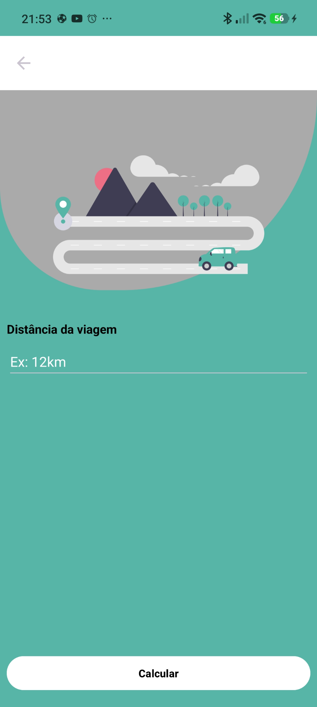

# ⛽ Fuel Calculator

Uma aplicação Android para estimar o gasto com combustível numa viagem.

## Sobre o app

O **Fuel Calculator** calcula o custo estimado de uma viagem a partir de três informações: o preço do combustível por litro, o consumo do veículo em quilómetros por litro e a distância a percorrer.

Desenvolvi este projeto em Kotlin durante um desafio de 10 dias, como parte da minha aprendizagem em desenvolvimento Android. Foi uma oportunidade para praticar a criação de interfaces, a navegação entre telas e a passagem de dados entre Activities.

## Telas do aplicativo

<table>
  <tr>
    <th>1. Preço do combustível</th>
    <th>2. Consumo do veículo</th>
    <th>3. Distância da viagem</th>
  </tr>
  <tr>
    <td></td>
    <td></td>
    <td></td>
  </tr>
</table>

## Tecnologias e conceitos utilizados

- **Kotlin:** linguagem utilizada na lógica da aplicação.
- **XML:** criação dos layouts das telas.
- **Android Studio:** ambiente de desenvolvimento.
- **Activities e Intents:** navegação e passagem de dados entre telas.
- **Gradle:** configuração e compilação do projeto.

- ## Lógica de Programação
- Tipos de variáveis
- Conversão de tipos
- Operadores matemáticos
- Operadores relacionais
- Manipulação de valores  

## Como utilizar

Com o aplicativo instalado e aberto no Android:

1. Informe o **preço do combustível por litro** e toque em **Próximo**.
2. Informe quantos **quilómetros o veículo percorre com um litro** e toque em **Próximo**.
3. Informe a **distância da viagem em quilómetros**.
4. Toque em **Calcular** para consultar o custo estimado da viagem.

Utilize valores maiores que zero. O consumo deve ser informado em **km/L**, não em L/100 km. A moeda do custo corresponde à moeda utilizada no preço por litro.

### Para executar o projeto

Abra a pasta principal do projeto no Android Studio, aguarde a sincronização do Gradle e execute o app num emulador ou dispositivo Android com depuração USB ativada.

## Resultado final

O resultado é uma estimativa do valor necessário para pagar o combustível da viagem, calculada pela fórmula:

```text
Custo da viagem = (distância ÷ consumo em km/L) × preço por litro
```

**Exemplo ilustrativo:** para uma viagem de 120 km, com um veículo que faz 12 km/L e combustível a 1,80 € por litro:

- Combustível necessário: 120 ÷ 12 = **10 litros**.
- Custo estimado: 10 × 1,80 € = **18,00 €**.

O valor considera apenas o combustível. O consumo real pode variar conforme o trânsito, o percurso e a condução.

Este projeto representa mais um passo na minha aprendizagem, aplicando conceitos de programação a uma necessidade do dia a dia.
